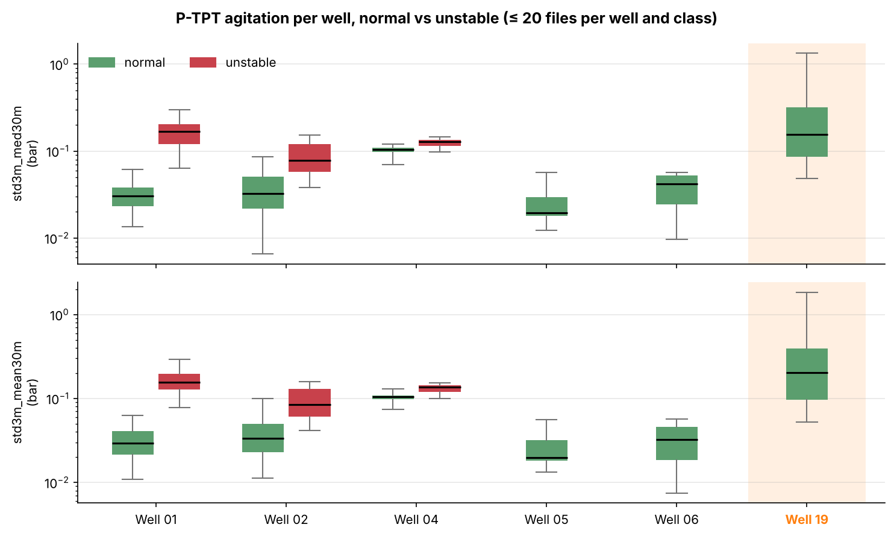

# Early Warning of Flow Instability in Offshore Oil Wells

Detecting flow instability (class 4) on real offshore sensor time series from the Petrobras **3W** dataset, with a temporal evaluation protocol: hyperparameters and alarm threshold are chosen on past data, and the future test period is evaluated once, at the end.

**Result on a held-out future period: 76% precision, 81% recall, 2% false-alarm rate.**

---

## Problem

Flow instability is a degraded flow regime in which sensor signals show non-periodic oscillations that stay within the tolerable range, which makes it hard for operators to spot in real time; it can evolve into slug flow, a more severe condition for the installations. The goal is to raise an alarm while the well is unstable, prioritising recall (a missed instability is costlier than a false alarm) while keeping false alarms low enough for operators to trust the system.

## Data

- [3W dataset](https://github.com/petrobras/3W) (Petrobras): multivariate sensor time series from real offshore wells, sampled every second.
- Files from folder `0` (normal operation) and folder `4` (flow instability), real wells only.
- Only one sensor is used: **P-TPT**, the pressure at the subsea Christmas tree, measured by the TPT (temperature and pressure transducer).
- The first hour of each file is unlabeled and is dropped after the features are computed.

## Approach

### 1. Exploratory analysis (`exploratory_data_analysis.py`)
- Normal vs unstable files of the same well, raw signal and rolling standard deviation, for P-TPT, T-TPT and P-MON-CKP.
- Distribution of the model features per well and class (box plots, log scale).
- Only files before 24 April 2017 are used: this script never loads the test period.

Main finding: instability shows up as **pressure agitation**, not as a pressure level. Absolute levels differ strongly from one well to another, so level-based features let a model recognise the well instead of the instability. Only variation-based features were kept.



### 2. Features
Computed per file on the 1 Hz signal, then subsampled to one row every 20 seconds:

| Feature | Definition |
|---|---|
| `std3m` | rolling standard deviation of P-TPT over 3 minutes (bar) |
| `std3m_med30m` | rolling median of `std3m` over 30 minutes |
| `std3m_mean30m` | rolling mean of `std3m` over 30 minutes |

### 3. Model (`model_evaluation.py`)
- Random forest (300 trees), `class_weight="balanced"`.
- **Monotonic constraints**: more agitation can never lower the predicted risk, which keeps the model physically consistent.

### 4. Evaluation protocol
Temporal walk-forward split, with a two-week gap (one-week embargo on each side of every cut) between every training and evaluation period:

| Set | Period |
|---|---|
| Fold 1 | train until 2014-09-23 → validate 2014-10-08 to 2017-02-21 |
| Fold 2 | train until 2017-02-21 → validate 2017-03-08 to 2017-04-23 |
| Final | train until 2017-04-23 → **test from 2017-05-08** |

- Grid search over `max_depth`, `min_samples_leaf` and `max_features` on fold 1.
- For each combination, the alarm threshold is chosen to maximise **F2** (recall weighted more than precision) on fold-1 validation.
- The selected hyperparameters and threshold are then frozen: the model is retrained on fold-2 training data and evaluated on fold-2 validation, then retrained on the full training period and evaluated **once** on the test period.

Selected configuration: `max_depth=2`, `min_samples_leaf=0.05`, `max_features=1`, threshold 0.784.

## Results

### Overall

| Set | Precision | Recall | F1 | False-alarm rate |
|---|---|---|---|---|
| Fold 1 (validation) | 0.905 | 0.977 | 0.940 | 0.9% |
| Fold 2 (validation) | 0.663 | 0.824 | 0.735 | 9.9% |
| **Test (future period)** | **0.764** | **0.812** | **0.787** | **2.2%** |

Fold 1 was used to choose the hyperparameters and the threshold, so its scores are optimistic. The test period is the only unbiased estimate.

Fold 2 precision is driven by a single file: 96% of its false-alarm hours come from the only normal file of well 19, whose background agitation matches real instabilities elsewhere (see Error analysis). Without that file, fold 2 reaches 0.978 precision and a 0.5% false-alarm rate, with unchanged recall.

### Test, per well

| Well | Class | Hours | Alarm rate |
|---|---|---|---|
| 01 | normal | 347 | 4% |
| 01 | unstable | 4 | 83% |
| 02 | normal | 598 | 3% |
| 03 | normal | 129 | 0% |
| 05 | normal | 178 | 0% |
| 05 | unstable | 76 | 100% |
| 06 | normal | 362 | 0% |
| 07 | normal | 4 | 0% |
| 07 | unstable | 20 | 100% |
| 14 | unstable | 42 | 39% |

Alarm rate = detection rate on unstable rows, false-alarm rate on normal rows.

- Wells 05, 07 and 14 are never unstable in the training data: 05 and 07 are detected at 100%, **well 14** only at 39%.
- Almost all missed detections come from well 14.
- False alarms come from wells 01 and 02: low rates, but on many hours of normal operation.

## Error analysis

On fold 2, **well 19** accounts for 96% of the false alarms (71% of its normal hours raise an alarm). Its only normal file combines:
- a background agitation during stable production comparable to the instabilities of other wells;
- an operator shutdown and restart sequence.

A model based on absolute agitation cannot separate this well from a real instability: the limitation comes from the feature, not from the model.

`error_exploration.py` gathers early per-well diagnostics on the first 30 files of wells 01, 02, 04 and 05, over the whole recording period: share of frozen sensor values, fast and slow pressure variations, and a leave-one-well-out decision tree on a first feature set (30-min 90th percentile, maximum, and share of 3-min agitation above 0.1 bar).

## Limitations

- **Single sensor**: wells 8 and 10 have no P-TPT data and are not covered.
- **Absolute agitation** does not transfer to wells with a high background agitation (well 19).
- **Weak instabilities** are under-detected (well 14).
- Fold 2 was used to diagnose errors, so it is not a fully blind validation either.

## Next steps

- Features describing the **structure of the oscillations** (spectral content, autocorrelation), not only their amplitude, to separate instability from a well's ordinary background noise.
- Agitation **relative to the well's own recent history**, to adapt to each well's background level.
- A fallback model on another sensor for wells without P-TPT.

## Repository

| File | Content |
|---|---|
| `exploratory_data_analysis.py` | signal comparisons and feature distributions per well |
| `model_evaluation.py` | data loading, features, walk-forward split, grid search, results per fold and per well, test |
| `error_exploration.py` | per-well diagnostics and leave-one-well-out comparison |

## How to run

```bash
pip install -r requirements.txt
```

Download the [3W dataset](https://github.com/petrobras/3W) and place its `dataset` folder at the root of this repository (or create a symbolic link named `dataset`), then run:

```bash
python exploratory_data_analysis.py
python model_evaluation.py
python error_exploration.py
```

Monotonic constraints in `RandomForestClassifier` require scikit-learn 1.4 or later.
